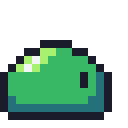

# Claude for PixelArt Design

Un flujo de trabajo para que **Claude Code** diseñe y anime sprites de pixel art, con **Aseprite**
como motor de exportación (y, opcionalmente, como lienzo en directo).

| idle S | move SE | attack E | death S |
|---|---|---|---|
|  |  |  |  |

La idea: los sprites se escriben como **texto** (una letra por color), y un script los convierte en un
`.aseprite` con un tag por animación, más spritesheet + JSON, PNG por frame y GIF de vista previa.
El texto es fácil de leer, editar y revisar para Claude (y para ti), y el build garantiza que todos
los frames tienen las mismas dimensiones.

## Qué instala

| Pieza | Para qué |
|---|---|
| Skill [`pixel-art-sprites`](https://skills.sh/omer-metin/skills-for-antigravity) | Reglas de pixel artist: tamaños, nº de frames, paletas con hue-shift, siluetas, escalado entero |
| Skill [`game-assets`](https://skills.sh/PlayableIntelligence/game-creator) | Sprites como código para juegos de navegador (Phaser) |
| MCP [aseprite-ai-mcp](https://github.com/PabloAlcoleaSesse/aseprite-ai-mcp) *(opcional)* | Claude dibuja en directo en tu Aseprite abierto |
| `tools/` (este repo) | Build de texto → `.aseprite` + exports |
| `CLAUDE.md` (este repo) | Le explica a Claude las convenciones del repo |

## Requisitos

- Windows + PowerShell (los scripts son `.ps1`).
- [Node.js](https://nodejs.org) 18+ (para instalar las skills y para los generadores).
- [Aseprite](https://www.aseprite.org) 1.3+ (comprado o compilado desde el código fuente).
- [Claude Code](https://claude.com/claude-code).
- Solo para el MCP: Python 3.10+ (lanzador `py`) y git.

## Instalación

```powershell
git clone https://github.com/ivanhidalgogarcia5/Claude-for-PixelArt-Design.git
cd Claude-for-PixelArt-Design
.\install.ps1          # skills
.\install.ps1 -Mcp     # skills + MCP de Aseprite (dibujo en directo)
```

Reinicia Claude Code después. Si Aseprite no está en una ruta estándar
(`C:\aseprite\build\bin`, `Program Files\Aseprite` o Steam), indícala:

```powershell
$env:ASEPRITE = 'D:\ruta\a\aseprite.exe'
```

Si PowerShell bloquea los scripts (`no se puede cargar ... la ejecución de scripts está deshabilitada`),
permite scripts locales para tu usuario: `Set-ExecutionPolicy -Scope CurrentUser RemoteSigned`.

Comprueba que todo funciona reconstruyendo el ejemplo:

```powershell
.\tools\build.ps1 -Sprite slime
```

## Guía de uso

### 1. Pídeselo a Claude

Abre Claude Code en la carpeta del repo y pide en lenguaje normal. Claude lee `CLAUDE.md` y usa la skill
automáticamente. Ejemplos:

- *"Haz un murciélago de 16x16 con idle, move, attack y death en las 5 direcciones."*
- *"El ataque del slime se lee poco: dale más anticipación."*
- *"Añade una animación de daño (hurt) de 2 frames al slime."*
- *"Haz una paleta de 5 colores para un esqueleto, con sombras frías."*

Claude escribe los `.txt`, ejecuta el build, mira el resultado ampliado y corrige lo que no se lea bien.

### 2. Estructura de un sprite

```
sprites/<nombre>/
├─ src/palette.txt          paleta compartida por todas sus animaciones
├─ src/<anim>_<dir>.txt     una animación por archivo (fuente editable)
├─ generate.js              opcional: genera los .txt a partir de poses
├─ <nombre>.aseprite        generado: un tag por archivo de src/
└─ export/                  generado
   ├─ <nombre>_sheet.png    spritesheet, una fila por animación
   ├─ <nombre>_sheet.json   frames, duraciones y frameTags (formato Aseprite json-array)
   ├─ <nombre>_<tag>_x8.gif vista previa ampliada
   └─ frames/<nombre>_<tag>_<n>.png
```

> `<nombre>.aseprite` y `export/` se **borran y regeneran** en cada build. Los cambios se hacen en `src/`.

### 3. Formato de los archivos de texto

`palette.txt`: una letra por color.

```
O=1a1c2c
D=257179
M=38b764
L=a7f070
W=f4f4f4
```

`<anim>_<dir>.txt`: `---- <milisegundos>` antes de cada frame y después una fila de texto por fila de
píxeles. `.` es transparente.

```
---- 200
................
......OOOO......
....OOLLMMOO....
...
```

El build falla con un mensaje claro si un frame no mide lo mismo que los demás o si usas una letra que no
está en la paleta.

### 4. Construir

```powershell
.\tools\build.ps1                 # todos los sprites
.\tools\build.ps1 -Sprite slime   # solo uno
```

### 5. Direcciones

Se dibujan 5 direcciones: **S, SE, E, NE, N**. **W, SW y NW son E, SE y NE volteados en horizontal**
(en el motor con `flipX`, o en Aseprite). Nombres de tag: `idle_s`, `move_ne`, `attack_e`, `death_n`…

Cuando muchas animaciones comparten poses (como el slime: 4 animaciones × 5 direcciones = 85 frames),
`generate.js` dibuja cada pose una vez y coloca los ojos según la dirección:

```powershell
node sprites\slime\generate.js
.\tools\build.ps1 -Sprite slime
```

### 6. Usarlo en un juego (Phaser 3)

```js
// config: { pixelArt: true }  → sin suavizado; escala siempre entera (2x, 3x…)
// preload():
this.load.atlas('slime', 'slime_sheet.png', 'slime_sheet.json');
this.load.json('slime_data', 'slime_sheet.json');
// create(): una animación por frameTag (from/to en meta.frameTags del JSON)
const data = this.cache.json.get('slime_data');
for (const t of data.meta.frameTags) {
  this.anims.create({
    key: t.name,
    frames: data.frames.slice(t.from, t.to + 1).map(f => ({ key: 'slime', frame: f.filename, duration: f.duration })),
    repeat: t.name.startsWith('death') || t.name.startsWith('attack') ? 0 : -1,
  });
}
```

Busca las animaciones **por nombre**, no por posición: los tags salen en orden alfabético. La hoja tiene
tantas columnas como la animación más larga; usa `from`/`to` del JSON y no celdas fijas.

### 7. Dibujo en directo con el MCP (opcional)

Con Aseprite abierto y el MCP instalado, Claude puede crear sprites y pintar píxeles en tu ventana de
Aseprite (`create_sprite`, `draw_pixels`, `preview_sprite`…). Es útil para bocetar; el MCP **no guarda**,
así que lo definitivo se pasa a `src/*.txt`. Si no conecta: en Aseprite, *File → Scripts → Connect AI MCP*.

## Créditos

- Skills: [omer-metin/skills-for-antigravity](https://github.com/omer-metin/skills-for-antigravity),
  [PlayableIntelligence/game-creator](https://github.com/PlayableIntelligence/game-creator).
- MCP: [PabloAlcoleaSesse/aseprite-ai-mcp](https://github.com/PabloAlcoleaSesse/aseprite-ai-mcp).
- Paleta del slime basada en *Sweetie 16* de GrafxKid.
- Guía de referencia: [Pixel Art Skills for Claude Code](https://skillselion.com/guides/pixel-art-skills-claude-code-guide).
